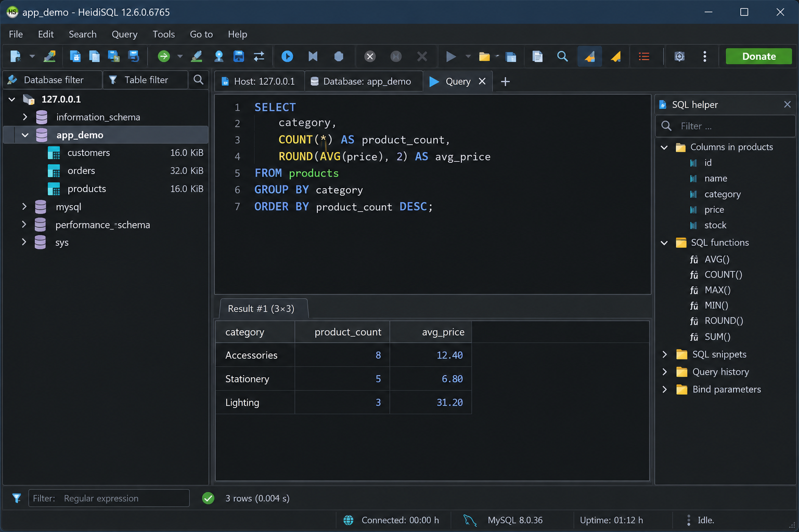
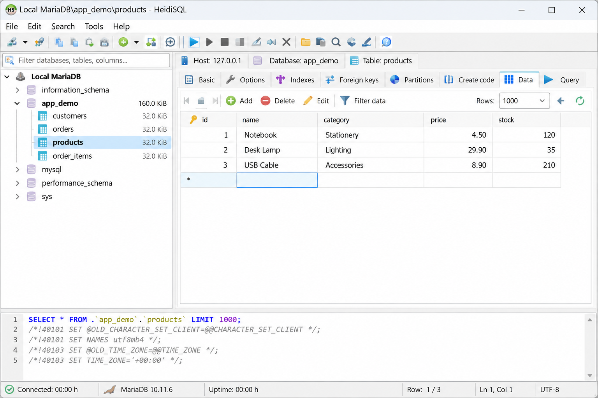
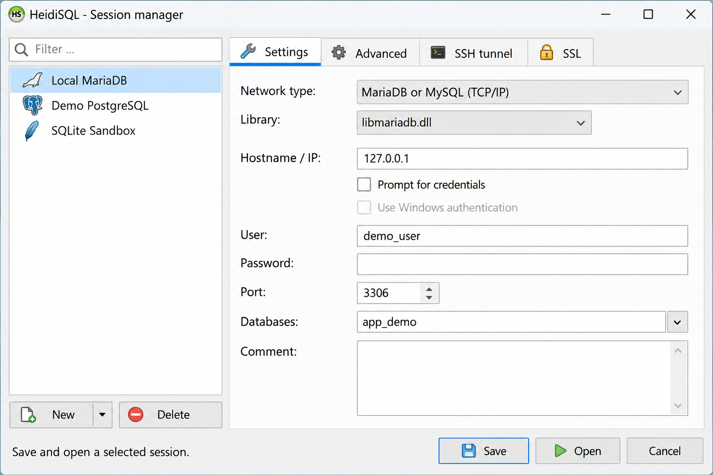

# Heidi SQL - Graphical Database Manager

HeidiSQL Database maintains Heidi SQL, an open-source desktop database client for browsing data, editing rows, managing database structures, and running SQL queries. Heidi SQL supports MySQL, MariaDB, PostgreSQL, Microsoft SQL Server, SQLite, Interbase, and Firebird.

## What it is

Heidi SQL provides a graphical workspace for developers, database administrators, analysts, and server operators. The HeidiSQL client combines connection management, a spreadsheet-like data editor, schema tools, an SQL editor, and import or export workflows in one Windows application.

### What is the use of HeidiSQL?

HeidiSQL is used to connect to relational database servers and manage their data without relying exclusively on command-line clients. Users can browse tables, filter records, edit values, execute SQL, and inspect query results from the Heidi SQL interface.

HeidiSQL Database also provides editors for tables, views, indexes, foreign keys, procedures, triggers, and scheduled events. Administrative workflows include managing users, examining active server processes, and stopping faulty queries. Connections can use TCP/IP, SSL, or a HeidiSQL SSH tunnel.

## Features

- Browse, filter, insert, update, and delete rows in a grid.
- Create and modify tables, columns, indexes, and foreign keys.
- Manage views, procedures, functions, triggers, and scheduled events.
- Write SQL with syntax highlighting, completion, search, and formatting.
- Open scripts with the HeidiSQL open SQL file workflow.
- Transfer structures and records with HeidiSQL import SQL and HeidiSQL export database operations.
- Use HeidiSQL import CSV and HeidiSQL export CSV for tabular data.
- Run a HeidiSQL export table to CSV operation for selected results.
- Generate a HeidiSQL dump database script for backup or migration.
- Manage multiple saved connections and active database sessions.
- Connect to local servers, remote hosts, AWS RDS, SSL endpoints, or SSH tunnels.
- Use HeidiSQL dark mode and configurable editor themes.

### How can I open a .SQL file?

Open Heidi SQL and connect to the server that should execute the script. Create or select a query tab, then use the editor’s file-opening command to load the `.SQL` file. Review the selected database and statement delimiters before executing anything, especially when the file contains destructive commands.

The HeidiSQL open SQL file workflow uses the query editor represented by [src/texteditor.pas](src/texteditor.pas) and [forms/texteditor.dfm](forms/texteditor.dfm). Large scripts can also be handled through the loading interface in [src/loaddata.pas](src/loaddata.pas). HeidiSQL import SQL should be tested against a disposable or backed-up database before production use.

### Database workflows

A HeidiSQL compare two databases workflow can inspect structures and generate the SQL needed to reconcile differences. The synchronization interface is implemented by [src/syncdb.pas](src/syncdb.pas) and [forms/syncdb.dfm](forms/syncdb.dfm). HeidiSQL synchronize database operations should always be reviewed before execution.

A HeidiSQL duplicate database workflow can export a source database and import that script into a new target. Heidi SQL can also transfer structure and data to another server. For a HeidiSQL local database, configure the loopback host and the database server’s normal port.

## Supported databases

| Database family | Heidi SQL support | Structure implementation |
|---|---|---|
| MySQL and MariaDB | Connections, data editing, schema management, queries, users, events, import, and export | [src/dbstructures.mysql.pas](src/dbstructures.mysql.pas) |
| PostgreSQL | Connections, data editing, objects, and SQL execution | [src/dbstructures.postgresql.pas](src/dbstructures.postgresql.pas) |
| Microsoft SQL Server | Connections, schemas, tables, views, and queries | [src/dbstructures.mssql.pas](src/dbstructures.mssql.pas) |
| SQLite | Local database files, tables, records, and queries | [src/dbstructures.sqlite.pas](src/dbstructures.sqlite.pas) |
| Interbase and Firebird | Connections, objects, records, and SQL execution | [src/dbstructures.interbase.pas](src/dbstructures.interbase.pas) |

The HeidiSQL supported databases layer shares common definitions from [src/dbstructures.pas](src/dbstructures.pas). HeidiSQL MySQL and HeidiSQL MariaDB use the same database family implementation, while HeidiSQL PostgreSQL, HeidiSQL SQL Server, HeidiSQL MSSQL, and HeidiSQL Firebird use database-specific metadata handling.

### Is MySQL still relevant in 2026?

Yes. MySQL remains relevant wherever applications need a mature relational database, broad hosting support, transactional storage, replication, and a familiar SQL ecosystem. The collected sources do not provide market-share measurements for 2026, so no ranking or usage volume should be inferred.

HeidiSQL MySQL remains one of the primary Heidi SQL workflows. The application supports schema editing, table data, indexes, foreign keys, procedures, events, user management, import, export, and server sessions. The same interface also makes HeidiSQL MariaDB useful for systems built on the closely related MariaDB platform.

### What are the top 3 relational databases?

There is no universal top three because the answer depends on deployment requirements, ecosystem, licensing, operational experience, and workload. For the main Heidi SQL workflows, three prominent database families are MySQL or MariaDB, PostgreSQL, and Microsoft SQL Server.

HeidiSQL MySQL is well suited to common web and hosted environments. HeidiSQL for PostgreSQL provides access to PostgreSQL databases and their relational structures. HeidiSQL SQL Server supports Microsoft SQL Server environments, while HeidiSQL Firebird remains available for Firebird and Interbase deployments.

### Find The Right Workflow

heidisql database, heidisql client, heidisql mysql, heidisql mariadb, heidisql for windows, heidisql ssh tunnel, database-client, database-management, sql-client, mysql, mariadb, postgresql, sql-server, firebird

## Compatibility

HeidiSQL for Windows is the primary build represented by HeidiSQL Database. The selected project files target Delphi and the Windows VCL.

HeidiSQL portable refers to running the application without a conventional installed configuration. The installer project is available in [heidisql.iss](heidisql.iss), while portable packaging depends on the produced application and its configuration strategy.

HeidiSQL Linux, HeidiSQL for Linux, and HeidiSQL for Ubuntu are separate platform interests. The upstream project directs non-Windows compilation to a Lazarus branch, but that branch is not included in this selected file set. This repository should therefore not be presented as a ready Linux build.

HeidiSQL online is not a browser edition of Heidi SQL. HeidiSQL Database is a desktop client that connects to database servers over supported network transports.

HeidiSQL AWS RDS uses the same host, port, credentials, SSL, and optional tunnel settings as other remote connections. HeidiSQL FiveM commonly refers to managing the MySQL or MariaDB database behind a FiveM server rather than a special Heidi SQL mode. HeidiSQL 10061 generally indicates that Windows could not establish the requested network connection, often because the host, port, service state, firewall, or tunnel is incorrect.

## Need help?

Start with the project entry points and the relevant editor or connection unit. Connection behavior is centered in [src/connections.pas](src/connections.pas) and [src/dbconnection.pas](src/dbconnection.pas). Query help is represented by [src/sqlhelp.pas](src/sqlhelp.pas) and [forms/sqlhelp.dfm](forms/sqlhelp.dfm).

Review [CHANGELOG](CHANGELOG) for historical changes, [CONTRIBUTING.md](CONTRIBUTING.md) before proposing a patch, and [SECURITY.md](SECURITY.md) before reporting a vulnerability. Do not publish passwords, private keys, connection strings, or production database contents in an issue.

## Building

Delphi 12.1 is the documented compiler for the Windows version of Heidi SQL. Older versions may fail, while newer versions require validation.

1. Open [heidisql.groupproj](heidisql.groupproj) or [heidisql.dproj](heidisql.dproj) in Delphi.
2. Install the required SynEdit and Virtual Treeview design-time packages.
3. Install the required exception-handling dependency used by the original project.
4. Confirm that generated resources and third-party components referenced by the project are available.
5. Build the project entry point in [heidisql.dpr](heidisql.dpr).
6. Validate the resulting HeidiSQL client against disposable test databases.

The selected repository contains SynEdit units such as [src/SynEdit.pas](src/SynEdit.pas), [src/SynEditHighlighter.pas](src/SynEditHighlighter.pas), and [src/SynHighlighterSQL.pas](src/SynHighlighterSQL.pas). It does not contain every upstream component or generated resource required by the full original build.

## Architecture

| Area | Files | Responsibility |
|---|---|---|
| Application | [src/main.pas](src/main.pas), [forms/main.dfm](forms/main.dfm) | Main Heidi SQL window and application coordination |
| Connections | [src/connections.pas](src/connections.pas), [src/dbconnection.pas](src/dbconnection.pas) | Saved sessions and database connectivity |
| Database metadata | [src/dbstructures.pas](src/dbstructures.pas) | Shared database structure model |
| Data editing | [src/grideditlinks.pas](src/grideditlinks.pas), [src/editvar.pas](src/editvar.pas) | Grid navigation and value editing |
| SQL editing | [src/texteditor.pas](src/texteditor.pas), [src/SynCompletionProposal.pas](src/SynCompletionProposal.pas) | SQL text editing and completion |
| Import and export | [src/loaddata.pas](src/loaddata.pas), [src/exportgrid.pas](src/exportgrid.pas) | Data loading and result export |
| Schema tools | [src/table_editor.pas](src/table_editor.pas), [src/routine_editor.pas](src/routine_editor.pas) | Table and routine management |
| User administration | [src/usermanager.pas](src/usermanager.pas), [src/change_password.pas](src/change_password.pas) | Accounts, privileges, and passwords |
| Synchronization | [src/syncdb.pas](src/syncdb.pas) | HeidiSQL synchronize database operations |

## Running tests

The selected HeidiSQL Database file set does not include an automated test suite. Validation should compile the Heidi SQL project and then exercise representative MySQL, MariaDB, PostgreSQL, SQL Server, SQLite, and Firebird connections.

Test data browsing, row editing, schema changes, SQL execution, cancellation, import, export, SSL, and SSH behavior against disposable databases. Visual checks should cover the main window, query editor, table editor, dialogs, light theme, and HeidiSQL dark mode. Never run destructive synchronization or duplicate-database checks against the only copy of production data.

## Translation

The complete upstream Heidi SQL project accepts community translations through its translation workflow. Translation catalogs are not part of this selected repository. UI changes should still avoid hard-coded text where the original application expects translatable resources.

## Contributing to HeidiSQL

HeidiSQL Database welcomes focused fixes to Heidi SQL. Read [CONTRIBUTING.md](CONTRIBUTING.md), associate a change with a reproducible issue, and keep patches limited to the reported problem.

Build the affected project, test the relevant database family, and visually inspect changed forms. Security-sensitive findings should follow [SECURITY.md](SECURITY.md) instead of a public report.

## License

Heidi SQL is distributed under the terms provided in [LICENSE](LICENSE). Included components may carry their own notices and licensing requirements. Review those terms before redistributing HeidiSQL Database builds or modified Heidi SQL source code.
